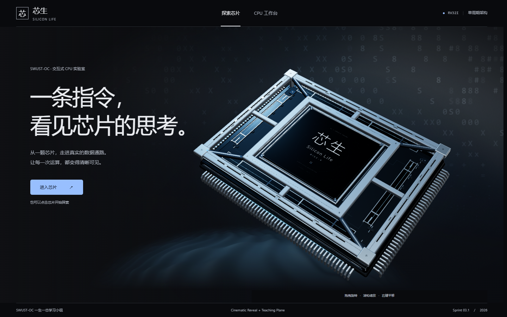
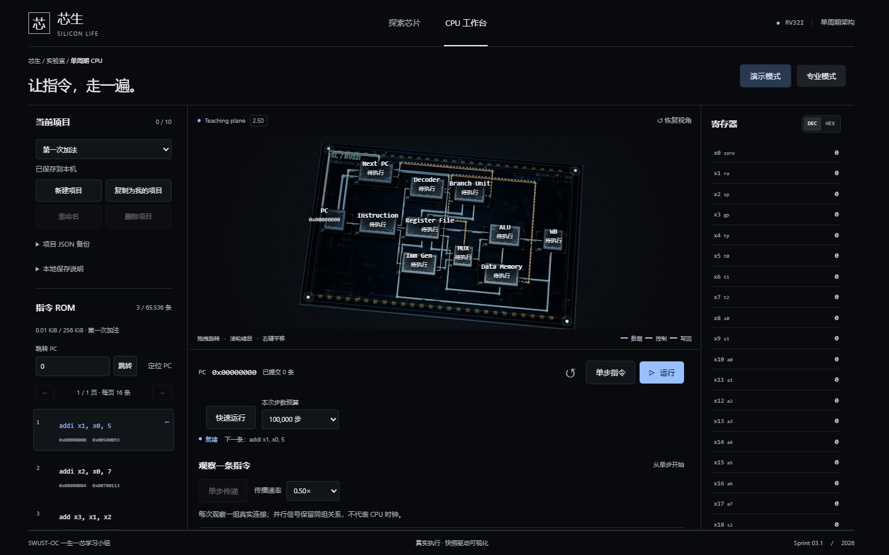

<div align="center">

# 芯生 · Silicon Life

### 一条指令，看见芯片的思考。

**基于 RISC-V RV32I 单周期架构的三维交互式 CPU 教学实验平台**

[在线体验](https://silicon-life.vercel.app/) · [功能介绍](#核心功能) · [快速开始](#快速开始) · [技术架构](#技术架构)

**2026 竞赛交付版本 · 功能冻结**

</div>

---

## 项目简介

**芯生（Silicon Life）** 是由西南科技大学参赛团队打造的浏览器端 CPU 探索实验平台。项目将 **RV32I 指令执行、RTL 功能结构、真实执行信号和三维空间交互** 结合起来，使抽象的计算机体系结构能够被观察、拆解与理解。

用户可以从芯片封装开始，进入单周期 CPU 数据通路，单步执行机器指令，观察寄存器、存储器及控制信号的变化；也可以进一步聚焦各个硬件功能模块，或通过 MMIO 外设查看程序实际写出的像素图像。

> **项目定位：** 用真实的软件执行状态驱动硬件教学可视化，而不是播放预先编排的假数据。三维结构是对 RTL 功能与数据通路的教学表达，不等同于门级网表或对 FPGA 的实时联合仿真。

## 作品展示

<p align="center">
  
</p>
<p align="center"><sub>精密三维芯片封装与电影化空间呈现</sub></p>

<p align="center">
  
</p>
<p align="center"><sub>单周期 CPU 教学电路板与信号通路（V3 阶段实机截图；最新界面请以在线版本为准）</sub></p>

## 核心功能

| 能力 | 说明 |
| --- | --- |
| **RV32I 指令执行** | 支持 40 条基础整数指令的教学执行，包括算术、逻辑、移位、分支、跳转及字节/半字/字访存；提供单步、运行和快速运行 |
| **11 个模块内部探索** | PC、Instruction Memory、Decoder、Register File、Imm Gen、MUX、ALU、WB、Data Memory、Branch Unit、Next PC 均可进入内部观察 |
| **真实数据通路追踪** | 由 CPU 状态和 ExecutionTrace 驱动信号、寄存器及存储器视图；支持暂停、回放、逐段观察与专业信号面板 |
| **三维交互体验** | 芯片封装拆解、连续镜头、模块聚焦和可逆返回；采用 Three.js / React Three Fiber 构建 |
| **ROM / RAM 实验** | 支持最多 1 MiB 指令 ROM、1 MiB 数据 RAM；支持 Logisim HEX 及统一内存镜像导入 |
| **真实 MMIO 显示** | 在 `0x20000000–0x2003FFFF` 地址区间支持 256 × 256 RGB888 显示设备，像素由实际执行的 32 位 SW 写入驱动 |
| **本地项目管理** | 最多 10 个自定义实验项目；支持 IndexedDB 自动保存、JSON 备份与 HEX 导入导出 |

### 11 个硬件探索模块

```text
PC ──────────────── Instruction Memory ─── Decoder
│                                           │
└── Next PC ◀── Branch Unit                ├── Imm Gen
                      ▲                     │
                      └── Register File ───┴── MUX ── ALU
                              ▲                        │
                              └────────── WB ◀─────────┤
                                        ▲               │
                                        └── Data Memory ┘
```

*上图为便于理解的模块关系概览，并非完整 RTL 网表或全部物理连线。*

## 在线体验

**[https://silicon-life.vercel.app/](https://silicon-life.vercel.app/)**

建议在支持 WebGL 的桌面浏览器中体验完整三维效果：

1. 在首页点击「进入芯片」，通过连续展开动画进入 CPU 工作台。
2. 选择内置示例，或导入自己的 RV32I 机器码 / Logisim HEX 文件。
3. 使用「单步指令」「运行」或「快速运行」观察程序执行及实时状态。
4. 点击主板上的功能模块，进入内部探索；使用「返回主板」或 `Esc` 返回。
5. 在工作台中添加 **MMIO Display** 外设，运行向显示地址写入像素的程序，观察真实帧缓冲。

**使用提示：** 浏览器中的项目配置保存在本机 IndexedDB，不会自动同步到其他设备。请使用 JSON 导出重要项目。显示设备的 3D 挂载属于会话视觉状态，不代表运行时热拔插地址解映射。

## 技术架构

```text
ROM / 自定义 RV32I 程序
           │
           ▼
   TypeScript CPU Core
     (RV32I · step)
           │
           ├──▶ CpuState ───▶ 寄存器 / RAM / MMIO 帧缓冲
           │
           └──▶ ExecutionTrace
                       │
                       ▼
             数据通路与教学播放
                       │
                       ▼
             React + Three.js / R3F
             三维芯片 · 元件探索 · 信号高亮
```

**主要技术：** TypeScript、React 19、Vite 7、Three.js、React Three Fiber、Drei、Zustand、Motion；测试工具为 Vitest 与 Playwright。

项目参考原有 RISC-V 单周期 CPU RTL 的模块划分和信号语义，**在浏览器中由 TypeScript CPU Core 执行指令**。原始 Verilog RTL 并未作为实时仿真引擎嵌入网页，也未声称完成 RTL 与软件模型的形式等价验证。

五个教学观察阶段用于分解一次指令执行的因果关系，**不代表五级流水线，也不是五个实际时钟周期**。

## 快速开始

**环境要求：** Node.js 22.12+，npm，支持 WebGL 的现代浏览器。

```bash
git clone https://github.com/JouCristian/Silicon-Life.git
cd Silicon-Life
npm ci
npm run dev
```

按终端输出访问本地开发地址（默认 `http://127.0.0.1:5173/`）。

如需构建静态生产资源：

```bash
npm run build
npm run preview
```

生产构建输出在 `dist/`，适用于 Vercel 等静态站点托管平台。

## 工程结构

```text
src/
├── core/            # RV32I 指令执行、存储器、设备与 Trace
├── scenes/          # 三维芯片、主板、模块内部探索
├── components/      # 工作台、寄存器、ROM/RAM、信号界面
├── motion/          # 镜头、动画和信号传播时间线
├── io/              # HEX、程序导入导出
├── projects/        # 本地项目存储与备份
└── tests/           # 单元与集成测试
docs/                # 架构、协议、设计及开发记录
examples/            # 示例机器码 / HEX
e2e/                 # 浏览器端验证
```

进一步阅读：

- [RTL 与 Web 信号映射](docs/RTL_MAPPING.md) · [RV32I 指令实现](docs/SPRINT_05_RV32I.md)
- [11 个模块探索说明](docs/SPRINT_07_EXPLORATION.md) · [MMIO 显示设备协议](docs/MMIO_DISPLAY.md)
- [HEX 文件格式](docs/HEX_FORMAT.md) · [系统架构](docs/ARCHITECTURE.md)
- [AI 使用记录](docs/AI_USAGE_LOG.md) · [第三方资源与许可](docs/THIRD_PARTY.md)

## 团队与创作说明

| 项目 | 信息 |
| --- | --- |
| 参赛作品 | **《芯生》——让每一条指令，都有迹可循** |
| 作品编号 | **456579** |
| 参赛学校 | 西南科技大学 |
| 团队成员 | 邹俊毅、陆惠彤、王明霞、汪昊、宗杰 |
| 指导教师 | 苏波 |
| 学习交流 | SWUST-OC · 一生一芯学习小组 |

本项目由团队提出创意方向、确定软硬件教学目标、提供 RTL 参考和测试素材，并参与交互设计、功能验证与人工验收。开发过程中使用 **ChatGPT** 辅助方案整理与内容表达、**Codex** 辅助工程实现与集成、**DeepSeek** 辅助三维视觉设计与交互迭代。AI 工具作为创作与工程辅助，不代替真实程序的执行结果；详细过程见 [AI 使用记录](docs/AI_USAGE_LOG.md)。

## 当前边界与版权说明

- 当前为 **2026 竞赛交付冻结版本**；不包含操作系统、CSR / 特权系统、扩展 ISA 或通用外设全集。
- MMIO 目前实现已验证的 RGB 显示写入协议，不提供通用 UART、键盘等外设功能；大型外部镜像需自行导入。
- 本仓库目前**未设置项目级开源许可证**；公开可查看不等于自动授予复制、修改或再分发许可。第三方组件遵循其各自许可证，详见 [THIRD_PARTY](docs/THIRD_PARTY.md)。

---

<div align="center">

**芯生 · Silicon Life**

*让每一条指令，都有迹可循。*

[在线体验](https://silicon-life.vercel.app/) · [GitHub 仓库](https://github.com/JouCristian/Silicon-Life)

</div>
