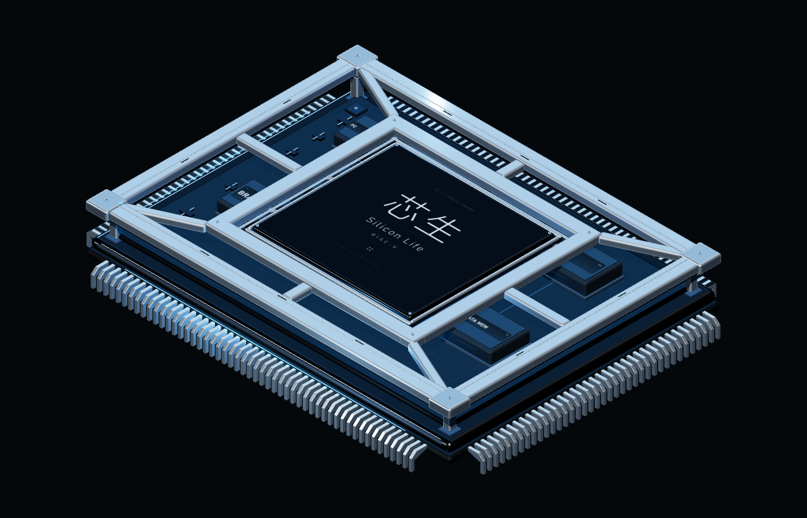
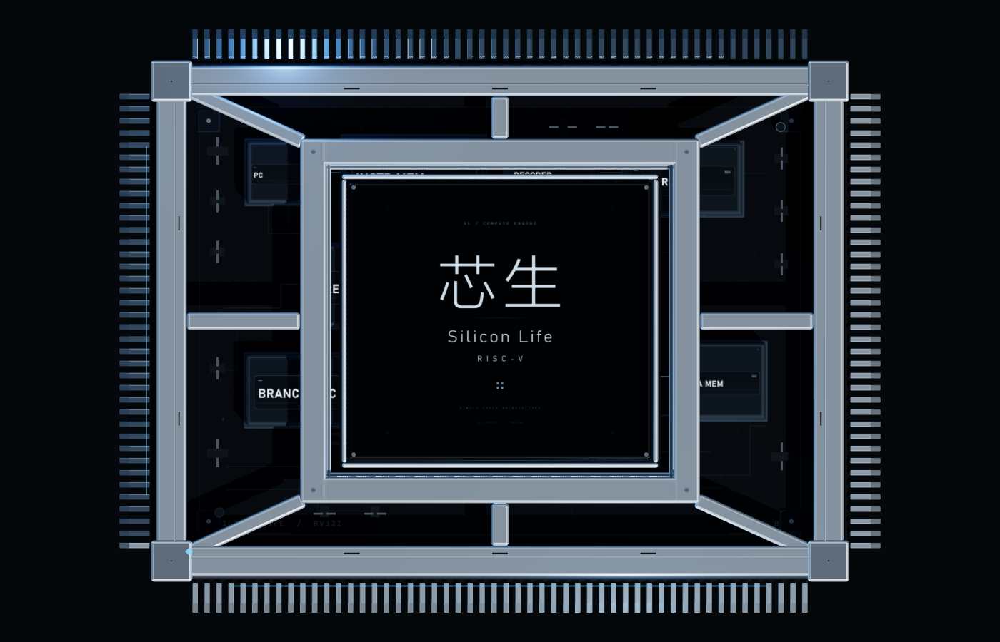
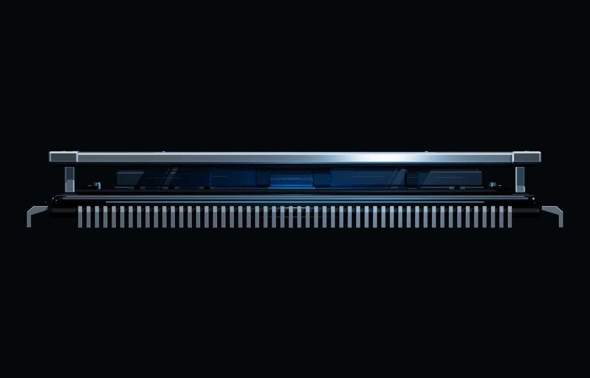
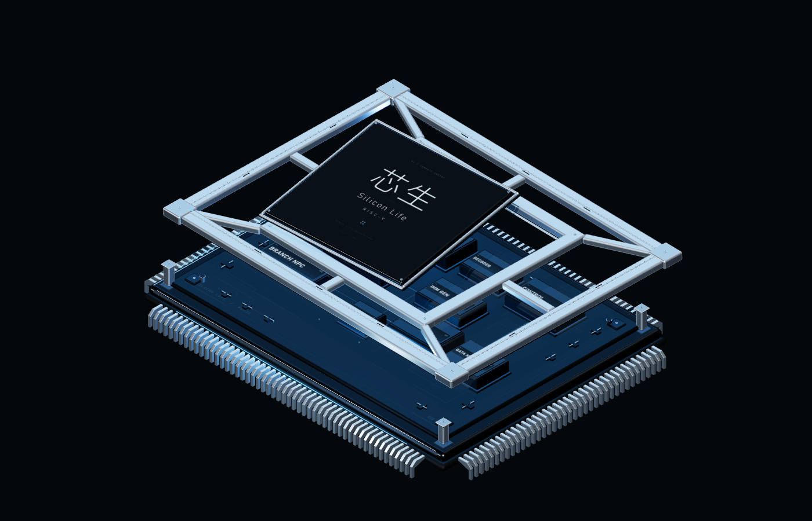
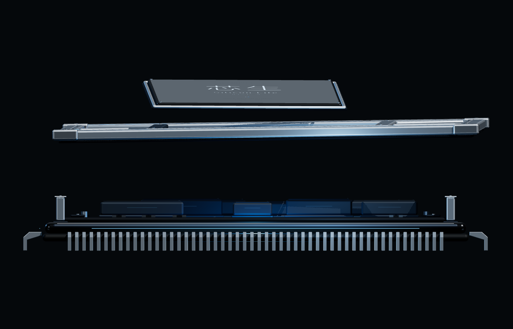
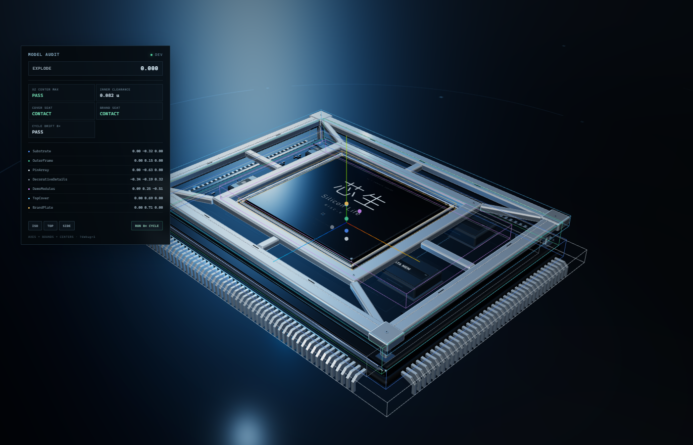

# 芯生 · Silicon Life — 3D 芯片结构原型 V2

独立实验目录，用于验证《芯生》RISC-V 单周期 CPU 教学网站的 3D 芯片视觉原型。

V2 集中修复机械结构、统一坐标与拆解姿态，不接入主工程，不修改 CPU Core、`CpuScene`、Store 或正式数据通路。所有结构均为 Three.js 程序化生成，不使用外部模型文件或预渲染视频。

运行：

```sh
node experiments/deepseek-chip-prototype/serve.mjs
# http://127.0.0.1:4174
```

也可以从仓库根目录运行 `npm run dev`，访问 `http://127.0.0.1:5173/experiments/deepseek-chip-prototype/`。

---

## V1 错位的根因

问题不是镜头，也不是简单的“看起来像支架”，而是三个变换基准被混用了。

1. **外壳枢轴被动画覆盖。**
   V1 的 `RemovableShellPivot` 初始位置是 `z = -CHIP_DEPTH / 2 + 0.08`，子级 `RemovableShell` 又向前补了 `z = +CHIP_DEPTH / 2 - 0.08`。这两个偏移本应互相抵消。
   但 `main.js` 的 `updateShell()` 每帧执行：

   ```js
   chip.cover.position.set(-1.72 * coverPark, 2.62 * coverLift, -1.72 * coverPark);
   ```

   在进度为 0 时，它把枢轴的 `z` 直接改成了 `0`，而子级仍然保留 `+4.12` 的补偿偏移。结果整个银色外框在装配状态下沿 `+Z` 平移了 4.12 个世界单位，看起来像一个独立支架。

2. **品牌层与外壳层各自使用不同的原点。**
   V1 的品牌组原点在芯片中心，但几何体位于局部 `y ≈ 1.08`；外壳使用后缘枢轴 + 反向子级偏移。拆解位移又直接在动画里写入位置，而不是从装配位置派生，导致两层横向错开。

3. **装配高度没有严格对齐。**
   外壳底梁、品牌载体和内部模块之间的垂直间隙靠肉眼调整。品牌载体实际上没有落在 Cover 的 seat lip 上，部分支撑关系是“看起来接近”，不是几何接触。

4. **相机透视放大了上述错误。**
   低机位和透视会把外壳在 Z 方向的 4.12 偏移投射成夸张的横向错位；修复几何之后，原有镜头不再需要掩盖任何东西。

需要明确：V1 的最终坐标并不会逐帧无限累加，因为 `updateShell()` 每帧都重新计算位置。真正的问题是**每一帧都在错误的基准上覆盖装配变换**；一旦初始基准（枢轴 Z）被抹掉，完整装配状态就已经错误。V2 把动画与装配彻底解耦：装配变换只记录一次，拆解姿态由装配变换派生，`setExplodeProgress()` 只做无状态插值。

V2 的修复原则是：**几何正确优先于构图。** 所有固定视角截图都使用正交相机，不依赖透视修饰。

---

## 统一坐标与层级

### 坐标约定

```text
ChipRoot 局部坐标
  +X  芯片右侧
  +Y  朝上（外盖方向）
  +Z  芯片正面
  (0, 0, 0)  完整封装（含针脚）的几何包围盒中心
```

模型创建完成后会自动测量完整装配状态下的包围盒，并把所有零件整体平移到包围盒中心，因此 `ChipRoot` 自身原点是真正的模型几何中心，而不是某个零件的安装点。

当前 V2 的标准化结果：

| 指标 | 数值 |
| --- | --- |
| 本地包围盒 | `X ±6.034`、`Y ±0.873`、`Z ±4.634` |
| 封装体尺寸 | `11.2 × 8.4` |
| 含针脚展开尺寸 | `12.068 × 9.268` |
| 本地几何中心 | `(0, 0, 0)` |
| 原型中 `ChipRoot.position` | `(0, 1.36, 0)` |
| 水平中心最大误差 | `0.000` |

### 零件树

```text
ChipRoot
├── Substrate            底层基板 / ceramic / internal deck
├── OuterFrame           固定式金属底盘、下沿和四根支撑柱
├── PinArray             180 根程序化 QFP 针脚
├── DecorativeDetails    PCB 装饰、走线、SMD、蓝色边缘光
├── DemoModules          10 个纯展示 CPU 模块（可隐藏 / 移除）
├── TopCover             可拆银色金属骨架盖
│   ├── 外框梁
│   ├── 中央品牌开口与 seat lip
│   ├── 斜撑 / 横桥 / 螺丝 / 触片
│   └── 四个定位接触片
└── BrandPlate           品牌玻璃、金属载体、RISC-V 字样
```

`TopCover` 和 `BrandPlate` 是可动画零件，其他为固定装配零件。

### 装配姿态

装配姿态是固定值，不随动画帧改变：

| 零件 | 局部位置（`ChipRoot` 原点） | 旋转 |
| --- | --- | --- |
| Substrate / OuterFrame / PinArray / DecorativeDetails / DemoModules | `(0, 0.018, 0)` | identity |
| TopCover | `(0, 0.698, 0)` | identity |
| BrandPlate | `(0, 0.6855, 0)` | identity |

关键几何接触：

- `BrandPlate` 载体底面：本地 `Y = 0.6105`
- `TopCover` seat lip 顶面：本地 `Y = 0.6105`
- 品牌载体与 seat lip 的实际间隙：`≈ 0`（接触，不穿插）
- Cover 接触片底面：本地 `Y = 0.5480`
- OuterFrame 支撑柱顶面：本地 `Y = 0.5505`
- 接触判定：`CONTACT`（允许 0.0025 的设计压合量）
- 内层盖板下方与 DemoModules 最高点：`+0.082`，不相交

### 拆解姿态

拆解姿态由装配姿态加固定 offset 派生，不重复累加：

| 零件 | 装配位置 | 拆解位置 | 水平位移 |
| --- | --- | --- | --- |
| TopCover | `(0, 0.698, 0)` | `(0.400, 2.278, -0.240)` | `0.466` |
| BrandPlate | `(0, 0.6855, 0)` | `(-0.280, 3.1855, 0.320)` | `0.425` |

- TopCover 额外旋转：`(0.020, -0.035, 0.015)` rad
- BrandPlate 额外旋转：`(0.140, 0.055, -0.012)` rad（轻微倾转，露出品牌面）
- 水平位移刻意保持很小；主要拆解方向为 `+Y`。
- 四条支撑柱留在基座上，拆开后能直接看到盖板的安装位置。

拆解进度映射：

```text
BrandPlate  = smootherstep(0.00, 0.62, progress)
TopCover    = smootherstep(0.18, 0.92, progress)
```

两者共用同一个外部进度，品牌层先抬升，外壳随后跟随。`setExplodeProgress()` 是幂等的：同一个进度值重复调用，输出变换完全一致。中途反向不会累积误差。

---

## 固定视角验收截图

以下截图由 `?capture=1` 的正交相机生成。截图模式隐藏所有产品 UI 与地面光效，不通过镜头透视修饰结构。

### 1. 完整芯片 · 45° 等轴测



### 2. 完整芯片 · 正上方



### 3. 完整芯片 · 正侧面



### 4. 完整拆解 · 45° 等轴测



### 5. 完整拆解 · 正侧面



### 附加：调试工具实拍



以上五张结构图与附加调试图可以直接重新生成：

```sh
node experiments/deepseek-chip-prototype/scripts/capture-views.mjs
```

要求本地静态服务器正在 `4174` 运行。脚本也支持 `CHIP_URL` 和 `CHIP_BROWSER` 环境变量。

---

## 模型 API

模型工厂位于 [src/chip.js](src/chip.js)，不依赖原型 UI、页面相机或信息面板。

```js
import { createChipModel } from './src/chip.js';

const model = createChipModel({
  demoModules: true, // false 时创建模型但隐藏 DemoModules
});

scene.add(model.root);
model.root.position.y = 1.36;

model.setExplodeProgress(0.35);
const cover = model.getPart('TopCover');
const brand = model.getPart('BrandPlate');
const poses = model.getPoses();
```

可用接口：

| 接口 | 说明 |
| --- | --- |
| `createChipModel(options)` | 创建完整芯片模型；`demoModules: false` 可隐藏演示模块 |
| `model.root` | 模型根节点，局部几何中心为 `(0,0,0)` |
| `model.parts` | 全部主要零件引用 |
| `getPart(name)` | 获取 `Substrate` / `OuterFrame` / `PinArray` / `DecorativeDetails` / `DemoModules` / `TopCover` / `BrandPlate` |
| `getParts()` | 获取全部零件映射 |
| `setExplodeProgress(0..1)` | 外部驱动拆解，幂等 |
| `getExplodeProgress()` | 当前拆解进度 |
| `getPoses()` | 返回 assembled / exploded 标准姿态副本 |
| `getAnimatedTransforms()` | 返回可动画零件的当前 position / quaternion（用于校验） |
| `setPartVisible(name, visible)` | 设置单个零件可见性 |
| `setModulesVisible(visible)` | 单独控制 DemoModules |
| `resetModel()` | 回到装配姿态并恢复 DemoModules |
| `getBounds(name, target?)` | 获取指定零件的 `Box3` |
| `assemblyReference` | 标准化后的装配基准高度（seat / pylon / carrier 等） |
| `dispose()` | 释放几何、材质、纹理并从父节点移除 |

> 透明度没有做成隐式全局开关：直接遍历 `getPart(name)` 内的材质并按需设置 `transparent / opacity`。如果需要只让某个零件透明，请先克隆共享材质，避免影响其他零件。

`DemoModules` 是独立 Group。未来接入正式工程时，建议：

1. 只取 `ChipRoot` 和六个精致外壳/基板零件。
2. `getPart('DemoModules').visible = false`，或从父级移除。
3. 用正式 `CpuScene` 的数据通路替代演示模块。
4. 不把原型的相机、地面、灯光、调试面板带入正式工程。

### React Three Fiber 集成示例

```jsx
import { useEffect, useMemo } from 'react';
import { useThree, useFrame } from '@react-three/fiber';
import { createChipModel } from './experiments/deepseek-chip-prototype/src/chip.js';

function ChipAsset({ explodeProgress = 0 }) {
  const { scene } = useThree();
  const model = useMemo(
    () => createChipModel({ demoModules: false }),
    [],
  );

  useEffect(() => {
    scene.add(model.root);
    return () => model.dispose();
  }, [model, scene]);

  useFrame(() => {
    model.setExplodeProgress(explodeProgress);
  });

  return null;
}
```

> 原型里的 `scene.js`、`main.js`、OrbitControls、灯光和相机不进入正式 R3F 场景。它们只是独立验证壳。

---

## 调试与验收

### 模型调试模式

```text
http://127.0.0.1:4174/?debug=1
```

仅在 query 参数存在时启用，正式页面不会创建调试对象。包含：

- `AxesHelper`：芯片统一坐标轴。
- 每个主要零件的彩色 Bounding Box。
- 每个主要零件的几何中心标记。
- 实时坐标面板：零件局部 center、拆解进度。
- `XZ CENTER MAX`：水平中心误差。
- `INNER CLEARANCE`：盖板内侧与演示模块的垂直间隙。
- `COVER SEAT` / `BRAND SEAT`：支撑柱与接触片、品牌载体与 seat lip 的接触状态。
- `CYCLE DRIFT 8×`：连续展开/收合 8 次后的坐标漂移。
- `RUN 8× CYCLE`、`ISO / TOP / SIDE` 视角按钮。

调试 API：

```js
window.__CHIP_DEBUG__.getReport()
window.__CHIP_DEBUG__.runCycleTest(8)
window.__CHIP_DEBUG__.setView('iso')
```

当前检查结果：

```json
{
  "centerError": 0,
  "coverClearance": 0.082,
  "seatGap": -0.0025,
  "brandSeatGap": 0,
  "cycleDrift": 0
}
```

Playwright 进一步做了 12 次强制展开/收合，`getAnimatedTransforms()` 在开始与结束时的 position / quaternion 完全一致。

### 结构截图模式

```text
?capture=1&view=iso&state=assembled
?capture=1&view=top&state=assembled
?capture=1&view=side&state=assembled
?capture=1&view=iso&state=exploded
?capture=1&view=side&state=exploded
```

`capture=1` 使用独立正交相机，自动按包围盒取景，并隐藏 UI 与地面。它不是产品展示功能，只用于结构审计与截图。固定视角定义为：

- `iso`：相机方向 `(1, 1, 1)`，屏幕上方向 `+Y`
- `top`：相机方向 `+Y`，屏幕上方向 `-Z`
- `side`：相机方向 `+Z`，屏幕上方向 `+Y`

---

## 浏览器回归验证

在本轮真实 Chrome / Playwright 中验证：

- 点击芯片展开、按钮合拢。
- 3D 模块点击选中、hover 高亮。
- 模块索引选中。
- 左键旋转、滚轮缩放、右键平移。
- 复位视角。
- 多次拆解/收回后组件坐标无漂移。
- 调试与 capture 模式均无浏览器 console 错误。
- 主工程类型检查、单元测试与生产构建通过。

```sh
npm run typecheck
npm test
npm run build
```

---

## 文件结构

```text
experiments/deepseek-chip-prototype/
├── index.html
├── style.css
├── main.js                  # 页面状态、相机、交互；不承载模型变换
├── serve.mjs
├── README.md
├── src/
│   ├── chip.js              # 统一坐标模型、装配/拆解姿态、模型 API
│   ├── scene.js             # 独立原型的相机、灯光、地面
│   ├── textures.js          # 程序化品牌字版、标签、环境贴图
│   ├── utils.js
│   ├── debug.js             # ?debug=1 的模型审计工具
│   └── capture.js           # ?capture=1 的正交结构截图模式
├── scripts/
│   └── capture-views.mjs    # 五张固定视角截图脚本
├── validation/
│   ├── 01-assembled-iso.png
│   ├── 02-assembled-top.png
│   ├── 03-assembled-side.png
│   ├── 04-exploded-iso.png
│   ├── 05-exploded-side.png
│   └── 06-debug-audit.png
└── vendor/
    ├── three.module.js      # Three.js r182
    ├── three.core.js
    ├── OrbitControls.js
    └── RoundedBoxGeometry.js
```

---

## 设计边界

- 这是工业风格的概念芯片，不宣称复刻真实商用封装工艺。
- 支撑柱、seat lip 与触片是简化机械结构，用于建立可读的装配关系。
- DemoModules 只保留 V1 的展示拓扑，不重新设计 CPU 数据通路。
- 未接入 ROM/RAM、MMIO、真实指令 Trace 或执行引擎。
- 本轮未 Push、Merge 或部署。
